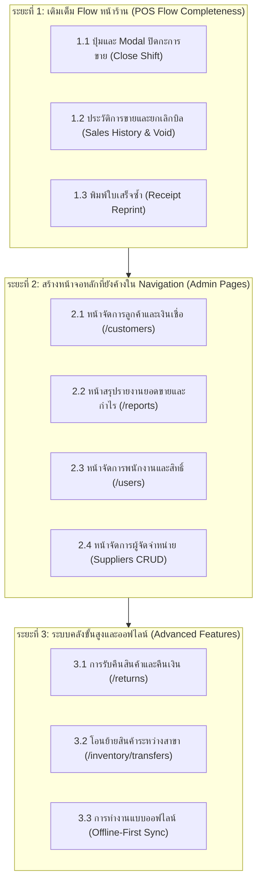

# เอกสารสถานะการเชื่อมต่อ API และแผนงานการพัฒนา (API Implementation Status & Roadmap)

> **โครงการ**: `ice-pos-web` (ระบบขายหน้าร้านและจัดการคลังสินค้า)  
> **แหล่งอ้างอิง Swagger ล่าสุด**: `http://localhost:8080/docs` (`docs/swagger.json`)  
> **API Version**: 1.2.0 | **Base Path**: `/api/v1` | **สถาปัตยกรรม Backend**: Go Fiber v3 Clean Architecture  
> **วันที่จัดทำ**: 28 ตุลาคม 2026  

---

## 1. สรุปภาพรวมสถานะการเชื่อมต่อ (Executive Dashboard)

ระบบ Backend มี Endpoint ทั้งหมด **81 Endpoints** แบ่งออกเป็น **17 กลุ่มฟังก์ชัน (Tags)** จากการตรวจสอบกับโค้ดฝั่งหน้าบ้าน (`src/services/`, `src/app/`, `src/components/`) มีสถานะดังนี้:

```
┌────────────────────────────────────────────────────────┐
│              สถานะการพัฒนา API ทั้งหมด 81 ตัว             │
├─────────────────────────┬──────────┬───────────────────┤
│ 🟢 เชื่อมต่อและใช้งานใน UI  │ 62 ตัว    │ 76.5%             │
│ 🟡 มี Service แต่ยังไม่มี UI │ 10 ตัว    │ 12.3%             │
│ 🔴 ยังไม่ได้ทำ (Remaining) │ 9 ตัว     │ 11.1%             │
└─────────────────────────┴──────────┴───────────────────┘
```

* **มี Service รองรับแล้วทั้งสิ้น**: 72 / 81 Endpoints (88.9%)
* **ส่วนที่เหลือต้องพัฒนาเพิ่ม**: 9 Endpoints (11.1%)

---

## 2. ตารางตรวจสอบสถานะรายโมดูล (Detailed API Matrix by Module)

สัญลักษณ์สถานะ:
* 🟢 **ใช้งานจริง (Implemented & Used)**: มีฟังก์ชัน Service และเชื่อมต่อกับ UI แล้ว
* 🟡 **มี Service รอ UI (Service Only)**: มีฟังก์ชัน Service แล้ว แต่ยังไม่มี Component/หน้าจอ หรือปุ่มกดเรียกใช้งาน
* 🔴 **ยังไม่ได้ทำ (Not Implemented)**: ยังไม่มีทั้ง Service และ UI ในระบบหน้าบ้าน

---

### 01. ระบบยืนยันตัวตน (Authentication & Branches) — 6 Endpoints
| Method | Endpoint | รายละเอียด | สถานะ | ฟังก์ชันใน Service | ตำแหน่งที่เรียกใช้งานใน UI |
|---|---|---|:---:|---|---|
| `POST` | `/auth/login` | เข้าสู่ระบบด้วย Username/Password | 🟢 | `authService.login` | `src/components/auth/CredentialLogin.tsx` |
| `POST` | `/auth/pin-login` | เข้าสู่ระบบแคชเชียร์ด้วยรหัส PIN | 🟢 | `authService.pinLogin` | `src/components/auth/PinLogin.tsx` |
| `GET` | `/branches` | ดูรายชื่อสาขาทั้งหมด | 🟢 | `authService.getBranches` | `BranchSelector.tsx`, `InventoryToolbar.tsx`, `PosOpenShiftModal.tsx` |
| `POST` | `/auth/logout` | ออกจากระบบและล้าง Token | 🟢 | `authService.logout` | `AppHeader.tsx`, `AuthContext.tsx` |
| `POST` | `/auth/refresh` | ต่ออายุ Access Token | 🟡 | `authService.refreshToken` | ทำงานอัตโนมัติผ่าน Token Coordinator ใน `src/services/api.ts` (ไม่มี UI) |
| `GET` | `/auth/me` | ดึงข้อมูลโปรไฟล์ผู้ใช้ปัจจุบัน | 🟡 | `authService.getMe` | ยังไม่ถูกเรียก (ปัจจุบันเก็บ Profile จากผลลัพธ์ของ Login) |

---

### 02. จัดการสินค้าและหมวดหมู่ (Product Catalog) — 18 Endpoints
| Method | Endpoint | รายละเอียด | สถานะ | ฟังก์ชันใน Service | ตำแหน่งที่เรียกใช้งานใน UI |
|---|---|---|:---:|---|---|
| `GET` | `/categories` | รายการหมวดหมู่ทั้งหมด | 🟢 | `catalogService.getCategories` | `catalog/page.tsx`, `PosCategoryTabs.tsx` |
| `POST` | `/categories` | สร้างหมวดหมู่ใหม่ | 🟢 | `catalogService.createCategory` | `CategoryFormModal.tsx` |
| `PUT` | `/categories/{id}` | แก้ไขหมวดหมู่ | 🟢 | `catalogService.updateCategory` | `CategoryFormModal.tsx` |
| `DELETE` | `/categories/{id}` | ลบหมวดหมู่ | 🟢 | `catalogService.deleteCategory` | `DeleteConfirmModal.tsx` |
| `GET` | `/products` | รายการสินค้าแบบ Pagination | 🟢 | `catalogService.getProducts` | `catalog/page.tsx`, `PosProductGrid.tsx`, `ProductSelectModal.tsx` |
| `POST` | `/products` | สร้างสินค้าใหม่ | 🟢 | `catalogService.createProduct` | `ProductFormDrawer.tsx`, `ProductFormModal.tsx` |
| `PUT` | `/products/{id}` | แก้ไขข้อมูลสินค้า | 🟢 | `catalogService.updateProduct` | `ProductFormDrawer.tsx`, `ProductFormModal.tsx` |
| `DELETE` | `/products/{id}` | ลบสินค้า | 🟢 | `catalogService.deleteProduct` | `DeleteConfirmModal.tsx` |
| `POST` | `/products/{id}/image` | อัปโหลดรูปภาพสินค้า | 🟢 | `catalogService.uploadProductImage` | `ImageUploader.tsx`, `CameraCaptureModal.tsx` |
| `POST` | `/products/{id}/internal-barcode` | สร้างบาร์โค้ดภายในร้าน | 🟢 | `catalogService.generateInternalBarcode` | `ProductFormDrawer.tsx`, `ProductFormModal.tsx` |
| `GET` | `/products/lookup/{code}` | ค้นหาสินค้าด้วยบาร์โค้ด | 🟢 | `catalogService.lookupProduct` | `useBarcodeScanner.ts`, `PosSearchBar.tsx` |
| `GET` | `/products/sku` | ตรวจสอบ/ค้นหา SKU ซ้ำ | 🟢 | `catalogService.searchProductsBySku` | `ProductFormDrawer.tsx` |
| `GET` | `/categories/{id}` | ดูหมวดหมู่ตาม ID | 🟡 | `catalogService.getCategoryById` | UI ดึงจาก State/Table List |
| `GET` | `/products/{id}` | ดูสินค้าตาม ID | 🟡 | `catalogService.getProductById` | UI ดึงจาก State/Table List |
| `POST` | `/uploads/images` | อัปโหลดรูปทั่วไปไม่ผูก ID | 🟡 | `catalogService.uploadImage` | ปัจจุบันใช้ `uploadProductImage` แทน |
| `GET` | `/products/barcode/{barcode}` | ค้นหาด้วยบาร์โค้ด (รูปแบบอื่น) | 🔴 | *ยังไม่มี* | ซ้ำซ้อนกับ `/products/lookup/{code}` |
| `GET` | `/products/lookup` | ค้นหา Prefix (Query Form) | 🔴 | *ยังไม่มี* | ซ้ำซ้อนกับ `/products/lookup/{code}` |
| `GET` | `/products/sku/{sku}` | ค้นหา SKU (Path Form) | 🔴 | *ยังไม่มี* | ปัจจุบันใช้ `/products/sku?sku=...` |

---

### 03. ข้อมูลตั้งค่าพื้นฐานสินค้า (Catalog Metadata) — 2 Endpoints
| Method | Endpoint | รายละเอียด | สถานะ | ฟังก์ชันใน Service | ตำแหน่งที่เรียกใช้งานใน UI |
|---|---|---|:---:|---|---|
| `GET` | `/taxes` | ดึงรายการอัตราภาษี | 🟢 | `metadataService.getTaxes` | `ProductFormDrawer.tsx`, `ProductFormModal.tsx` |
| `GET` | `/uoms` | ดึงรายการหน่วยนับสินค้า | 🟢 | `metadataService.getUoms` | `ProductFormDrawer.tsx`, `ProductFormModal.tsx` |

---

### 04. ลูกค้าและบัญชีเงินเชื่อ (Customers & Credit) — 7 Endpoints
| Method | Endpoint | รายละเอียด | สถานะ | ฟังก์ชันใน Service | ตำแหน่งที่เรียกใช้งานใน UI |
|---|---|---|:---:|---|---|
| `GET` | `/customers` | ค้นหารายการลูกค้าและยอดหนี้ | 🟢 | `customerService.searchCustomers` | `PosPaymentCredit.tsx`, `customers/page.tsx` |
| `GET` | `/customers/{id}` | ดูข้อมูลลูกค้าตาม ID | 🟡 | `customerService.getCustomerById` | มี Service รองรับใน `customer.service.ts` |
| `POST` | `/customers` | ลงทะเบียนลูกค้าใหม่และเปิดบัญชีเงินเชื่อ | 🟢 | `customerService.createCustomer` | `customers/page.tsx`, `CustomerFormModal.tsx` |
| `PUT` | `/customers/{id}` | แก้ไขข้อมูลลูกค้า | 🟢 | `customerService.updateCustomer` | `customers/page.tsx`, `CustomerFormModal.tsx` |
| `DELETE` | `/customers/{id}` | ลบข้อมูลลูกค้า | 🟢 | `customerService.deleteCustomer` | `customers/page.tsx` |
| `PUT` | `/customers/{id}/credit-limit` | ปรับวงเงินเครดิตลูกค้า | 🟢 | `customerService.updateCreditLimit` | `CreditLimitModal.tsx` |
| `POST` | `/customers/{id}/pay-credit` | บันทึกการชำระหนี้/ตัดยอดเงินเชื่อ | 🟢 | `customerService.payCredit` | `PayCreditModal.tsx` |
| `GET` | `/customers/reports/ar-aging` | รายงานลูกหนี้ค้างชำระตามอายุหนี้ | 🟢 | `customerService.getARAgingReport` | `ARAgingReportModal.tsx` |

---

### 04.1 ผู้จัดจำหน่าย (Suppliers) — 5 Endpoints
| Method | Endpoint | รายละเอียด | สถานะ | ฟังก์ชันใน Service | ตำแหน่งที่เรียกใช้งานใน UI |
|---|---|---|:---:|---|---|
| `GET` | `/suppliers` | รายการผู้จัดจำหน่ายทั้งหมด | 🟢 | `procurementService.getSuppliers` | `inventory/page.tsx`, `SupplierTable.tsx`, Dropdown ใน PO/GR |
| `GET` | `/suppliers/{id}` | ดูข้อมูลผู้จัดจำหน่ายตาม ID | 🟡 | `procurementService.getSupplierById` | UI ดึงจาก List Dropdown |
| `POST` | `/suppliers` | สร้างผู้จัดจำหน่ายใหม่ | 🟢 | `procurementService.createSupplier` | `SupplierFormModal.tsx` |
| `PUT` | `/suppliers/{id}` | แก้ไขผู้จัดจำหน่าย | 🟢 | `procurementService.updateSupplier` | `SupplierFormModal.tsx` |
| `DELETE` | `/suppliers/{id}` | ลบ/ปิดการใช้งานผู้จัดจำหน่าย | 🟢 | `procurementService.deleteSupplier` | `SupplierTable.tsx` |

---

### 04.2 ใบสั่งซื้อสินค้า (Purchase Orders) — 8 Endpoints
| Method | Endpoint | รายละเอียด | สถานะ | ฟังก์ชันใน Service | ตำแหน่งที่เรียกใช้งานใน UI |
|---|---|---|:---:|---|---|
| `GET` | `/purchase-orders` | รายการใบสั่งซื้อสินค้า | 🟢 | `procurementService.getPurchaseOrders` | `inventory/page.tsx`, `PurchaseOrderTable.tsx` |
| `POST` | `/purchase-orders` | สร้างใบสั่งซื้อใหม่ (DRAFT) | 🟢 | `procurementService.createPurchaseOrder` | `CreatePurchaseOrderModal.tsx` |
| `POST` | `/purchase-orders/{id}/confirm` | ยืนยันใบสั่งซื้อ (ORDERED) | 🟢 | `procurementService.confirmPurchaseOrder` | `PurchaseOrderDetailModal.tsx` |
| `POST` | `/purchase-orders/{id}/cancel` | ยกเลิกใบสั่งซื้อ | 🟢 | `procurementService.cancelPurchaseOrder` | `PurchaseOrderDetailModal.tsx` |
| `POST` | `/purchase-orders/{id}/close` | บังคับปิดใบสั่งซื้อ (Force Close) | 🟢 | `procurementService.forceClosePurchaseOrder` | `PurchaseOrderDetailModal.tsx` |
| `GET` | `/purchase-orders/{id}/receipt-preview`| ดึงรายการสินค้าค้างรับ | 🟢 | `procurementService.getReceiptPreview` | `CreateGoodsReceiptModal.tsx` |
| `GET` | `/purchase-orders/{id}` | ดูรายละเอียด PO ตาม ID | 🟡 | `procurementService.getPurchaseOrderById` | UI ดึงจาก Table Row Props |
| `PUT` | `/purchase-orders/{id}` | แก้ไขใบสั่งซื้อ (สถานะ DRAFT) | 🟡 | `procurementService.updatePurchaseOrder` | มี Service แต่ยังไม่มี Edit Modal |

---

### 04.3 ตรวจรับสินค้าเข้าคลัง (Goods Receipts) — 5 Endpoints
| Method | Endpoint | รายละเอียด | สถานะ | ฟังก์ชันใน Service | ตำแหน่งที่เรียกใช้งานใน UI |
|---|---|---|:---:|---|---|
| `GET` | `/goods-receipts` | รายการใบตรวจรับสินค้า | 🟢 | `procurementService.getGoodsReceipts` | `inventory/page.tsx`, `GoodsReceiptTable.tsx` |
| `POST` | `/goods-receipts` | สร้างใบตรวจรับสินค้า | 🟢 | `procurementService.createGoodsReceipt` | `CreateGoodsReceiptModal.tsx` |
| `POST` | `/goods-receipts/{id}/complete` | ยืนยันตรวจรับเข้าสต็อกจริง | 🟢 | `procurementService.completeGoodsReceipt` | `GoodsReceiptDetailModal.tsx` |
| `POST` | `/goods-receipts/{id}/cancel` | ยกเลิกใบตรวจรับสินค้า | 🟢 | `procurementService.cancelGoodsReceipt` | `GoodsReceiptDetailModal.tsx` |
| `GET` | `/goods-receipts/{id}` | ดูรายละเอียดใบตรวจรับตาม ID | 🟡 | `procurementService.getGoodsReceiptById` | UI ดึงจาก Table Row Props |

---

### 05. คลังและสต็อกสินค้า (Inventory & Stock) — 4 Endpoints
| Method | Endpoint | รายละเอียด | สถานะ | ฟังก์ชันใน Service | ตำแหน่งที่เรียกใช้งานใน UI |
|---|---|---|:---:|---|---|
| `GET` | `/inventory/stocks` | ดูยอดสต็อกคงเหลือรายสาขา | 🟢 | `inventoryService.getStockLevels` | `inventory/page.tsx`, `InventoryStockTable.tsx`, `posStockHelper.ts` |
| `POST` | `/inventory/adjust` | ปรับยอดสต็อกสินค้า (นับ/ชำรุด) | 🟢 | `inventoryService.adjustStock` | `StockAdjustmentModal.tsx` |
| `POST` | `/inventory/transfers` | สร้างใบโอนย้ายสินค้าระหว่างสาขา | 🔴 | *ยังไม่มี* | ยังไม่มีระบบโอนย้ายสินค้า |
| `POST` | `/inventory/transfers/{id}/receive`| รับสินค้าโอนย้ายเข้าสาขา | 🔴 | *ยังไม่มี* | ยังไม่มีระบบโอนย้ายสินค้า |

---

### 06. กะการทำงานและลิ้นชักเก็บเงิน (Shifts & Cash Drawer) — 3 Endpoints
| Method | Endpoint | รายละเอียด | สถานะ | ฟังก์ชันใน Service | ตำแหน่งที่เรียกใช้งานใน UI |
|---|---|---|:---:|---|---|
| `GET` | `/shifts/active` | ตรวจสอบกะขายที่กำลังเปิดอยู่ | 🟢 | `shiftService.getActiveShift` | `pos/page.tsx`, `PosShiftBanner.tsx` |
| `POST` | `/shifts/open` | เปิดกะการขายพร้อมเงินทอน | 🟢 | `shiftService.openShift` | `PosOpenShiftModal.tsx` |
| `POST` | `/shifts/{id}/close` | ปิดกะการขายและกระทบยอดเงินสด | 🟢 | `shiftService.closeShift` | `PosCloseShiftModal.tsx`, `PosShiftBanner.tsx` |

---

### 07. รายการขายและชำระเงิน (Sales & Checkout) — 4 Endpoints
| Method | Endpoint | รายละเอียด | สถานะ | ฟังก์ชันใน Service | ตำแหน่งที่เรียกใช้งานใน UI |
|---|---|---|:---:|---|---|
| `POST` | `/sales` | บันทึกการขายหน้าร้าน (Checkout) | 🟢 | `salesService.createSale` | `PosCheckoutModal.tsx` |
| `GET` | `/sales/{id}` | ดูรายละเอียดบิลขายตาม ID | 🟢 | `salesService.getSaleById` | `PosSalesHistoryModal.tsx` |
| `GET` | `/sales` | ค้นหาและดูประวัติการขาย | 🟢 | `salesService.getSalesHistory` | `PosSalesHistoryModal.tsx` |
| `POST` | `/sales/{id}/void` | ยกเลิกบิลขาย (Void Sale) | 🟢 | `salesService.voidSale` | `PosVoidConfirmModal.tsx`, `PosSalesHistoryModal.tsx` |

---

### 08. การรับคืนสินค้าและคืนเงิน (Returns & Refunds) — 1 Endpoint
| Method | Endpoint | รายละเอียด | สถานะ | ฟังก์ชันใน Service | ตำแหน่งที่เรียกใช้งานใน UI |
|---|---|---|:---:|---|---|
| `POST` | `/returns` | ทำรายการรับคืนสินค้าและคืนเงิน | 🔴 | *ยังไม่มี* | ยังไม่มีระบบรับคืนสินค้า |

---

### 09. ใบเสร็จรับเงิน (Receipts) — 1 Endpoint
| Method | Endpoint | รายละเอียด | สถานะ | ฟังก์ชันใน Service | ตำแหน่งที่เรียกใช้งานใน UI |
|---|---|---|:---:|---|---|
| `GET` | `/receipts/{receiptNo}` | ข้อมูลใบเสร็จสำหรับสั่งพิมพ์ซ้ำ | 🟢 | `receiptService.getReceiptByNo` | `PosReceiptModal.tsx`, `PosSalesHistoryModal.tsx`, `PosSuccessOverlay.tsx` |

---

### 10. ช่องทางชำระเงินและพร้อมเพย์ (Payments & QR PromptPay) — 2 Endpoints
| Method | Endpoint | รายละเอียด | สถานะ | ฟังก์ชันใน Service | ตำแหน่งที่เรียกใช้งานใน UI |
|---|---|---|:---:|---|---|
| `POST` | `/payments/qr` | สร้าง QR Code พร้อมเพย์ตามยอดเงิน | 🟢 | `paymentsService.generatePromptPayQR` | `PosPaymentQR.tsx` |
| `GET` | `/payments/{ref}/status` | ตรวจสอบสถานะการจ่ายเงิน QR | 🟢 | `paymentsService.checkPaymentStatus` | `PosPaymentQR.tsx` (Polling) |

---

### 11. รายงานและการวิเคราะห์ (Reports & Analytics) — 3 Endpoints
| Method | Endpoint | รายละเอียด | สถานะ | ฟังก์ชันใน Service | ตำแหน่งที่เรียกใช้งานใน UI |
|---|---|---|:---:|---|---|
| `GET` | `/reports/inventory-valuation` | รายงานมูลค่าสินค้าคงคลังรวม | 🟢 | `inventoryService.getInventoryValuation` | `InventorySummaryCards.tsx` |
| `GET` | `/reports/best-sellers` | รายงานสินค้าขายดีตามช่วงเวลา | 🟢 | `reportService.getBestSellers` | `reports/page.tsx` |
| `GET` | `/reports/sales-summary` | รายงานสรุปยอดขาย กำไรขั้นต้น และภาษี | 🟢 | `reportService.getSalesSummary` | `reports/page.tsx` |

---

### 12. การเชื่อมต่อแบบออฟไลน์ (Offline Synchronization) — 2 Endpoints
| Method | Endpoint | รายละเอียด | สถานะ | ฟังก์ชันใน Service | ตำแหน่งที่เรียกใช้งานใน UI |
|---|---|---|:---:|---|---|
| `POST` | `/sync/batch` | อัปโหลดรายการขายและสต็อกตอนออฟไลน์ | 🔴 | *ยังไม่มี* | ยังไม่ได้เชื่อมต่อระบบ Local DB Sync |
| `GET` | `/sync/changes` | ดึงข้อมูลความเปลี่ยนแปลงลงแคช POS | 🔴 | *ยังไม่มี* | ยังไม่ได้เชื่อมต่อระบบ Local DB Sync |

---

### 02. ระบบจัดการสมาชิกและผู้ใช้งาน (User Management) — 8 Endpoints
| Method | Endpoint | รายละเอียด | สถานะ | ฟังก์ชันใน Service | ตำแหน่งที่เรียกใช้งานใน UI |
|---|---|---|:---:|---|---|
| `GET` | `/users` | ดึงรายชื่อพนักงานทั้งหมด | 🟢 | `userService.getUsers` | `users/page.tsx` |
| `POST` | `/users` | สร้างบัญชีผู้ใช้งานใหม่ | 🟢 | `userService.createUser` | `UserFormModal.tsx` |
| `GET` | `/users/{id}` | ดึงข้อมูลพนักงานตาม ID | 🟢 | `userService.getUserById` | `users/page.tsx` |
| `PUT` | `/users/{id}` | แก้ไขข้อมูลพนักงาน | 🟢 | `userService.updateUser` | `UserFormModal.tsx` |
| `DELETE` | `/users/{id}` | ระงับการใช้งานบัญชีพนักงาน (Soft Delete) | 🟢 | `userService.deleteUser` | `users/page.tsx` |
| `POST` | `/users/{id}/reset-password` | รีเซ็ตรหัสผ่านพนักงาน | 🟢 | `userService.resetPassword` | `ResetPasswordModal.tsx` |
| `POST` | `/users/{id}/reset-pin` | รีเซ็ต PIN แคชเชียร์ | 🟢 | `userService.resetPin` | `ResetPinModal.tsx` |
| `POST` | `/users/{id}/unlock` | ปลดล็อกบัญชีพนักงาน | 🟢 | `userService.unlockUser` | `users/page.tsx` |

---

### 00. ระบบ (System & Health) — 1 Endpoint
| Method | Endpoint | รายละเอียด | สถานะ | ฟังก์ชันใน Service | ตำแหน่งที่เรียกใช้งานใน UI |
|---|---|---|:---:|---|---|
| `GET` | `/health` | ตรวจสอบสถานะเซิร์ฟเวอร์ Backend | 🔴 | *ยังไม่มี* | ไม่จำเป็นต้องมี UI ฝั่งผู้ใช้ |

---

## 3. แผนการดำเนินงานพัฒนาต่อยอด (Implementation Roadmap)

เพื่อให้ระบบ `ice-pos-web` มีความสมบูรณ์และพร้อมใช้งานจริงอย่างมีประสิทธิภาพ จึงจัดลำดับความสำคัญในการพัฒนาต่อเป็น 3 ระยะ:



---

### ระยะที่ 1: เติมเต็ม Flow หน้าร้านที่สำคัญ (High Priority) — ✅ ดำเนินการเสร็จสมบูรณ์แล้ว — ✅ ดำเนินการเสร็จสมบูรณ์แล้ว — ✅ ดำเนินการเสร็จสมบูรณ์แล้ว
มุ่งเน้นการปิดวงจรการขายหน้าร้าน (Cashier Lifecycle) ให้ครบสมบูรณ์:

1. **ระบบปิดกะการขาย (Close Shift Modal)**
   * **Endpoint**: `POST /shifts/{id}/close` (มีใน `shift.service.ts` แล้ว)
   * **งานที่ต้องทำ**:
     * เพิ่มปุ่ม "ปิดกะ" ใน `src/components/pos/PosShiftBanner.tsx`
     * สร้าง Modal นับเงินสดจริงในลิ้นชัก (Actual Cash Amount)
     * แสดงผลกระทบยอดเงินสด ส่วนต่าง (Overage / Shortage) และปิดกะสำเร็จ

2. **ระบบประวัติการขายและการยกเลิกบิล (Sales History & Void Sale)**
   * **Endpoint**: `GET /sales`, `POST /sales/{id}/void`, `GET /sales/{id}`
   * **งานที่ต้องทำ**:
     * สร้าง `src/services/sales.service.ts` เพิ่มเติมฟังก์ชัน `getSalesHistory`, `voidSale`
     * สร้างหน้าจอหรือ Modal ค้นหาบิลขายย้อนหลังตามวันที่/เลขที่บิล
     * รองรับการกดยกเลิกบิล (Void) พร้อมระบุเหตุผล เพื่อให้สต็อกสินค้าคืนกลับคลังโดยอัตโนมัติ

3. **การพิมพ์ใบเสร็จซ้ำ (Receipt Reprint)**
   * **Endpoint**: `GET /receipts/{receiptNo}`
   * **งานที่ต้องทำ**: สร้าง Service สำหรับดึงข้อมูลใบเสร็จและหน้าต่างพิมพ์สำหรับ Thermal Printer (80mm/58mm)

---

### ระยะที่ 2: พัฒนาหน้าจอหลักตามเมนูนำทาง (Medium Priority) — ✅ ดำเนินการเสร็จสมบูรณ์แล้ว
มุ่งเน้นการสร้าง Page สำหรับเมนูใน Sidebar ที่ยังไม่มีหน้าจอรองรับ:

1. **ระบบจัดการลูกค้าและบัญชีเงินเชื่อ (`src/app/(main)/customers/page.tsx`)**
   * **Endpoints**: `POST /customers`, `PUT /customers/{id}`, `DELETE /customers/{id}`, `PUT /customers/{id}/credit-limit`, `POST /customers/{id}/pay-credit`, `GET /customers/reports/ar-aging`
   * **งานที่ต้องทำ**:
     * สร้าง `customerService` ให้ครบทุก CRUD
     * ตารางรายชื่อลูกค้า ยอดวงเงินคงเหลือ ยอดหนี้ค้างชำระ
     * ฟอร์มเปิดบัญชีลูกค้า / กำหนดวงเงินเครดิต
     * Modal บันทึกการรับชำระเงินเพื่อลดยอดหนี้
     * หน้ารายงานลูกหนี้ตามอายุหนี้ (AR Aging: 30 วัน, 60 วัน, 90 วัน)

2. **ระบบรายงานสรุปยอดขายและการวิเคราะห์ (`src/app/(main)/reports/page.tsx`)**
   * **Endpoints**: `GET /reports/sales-summary`, `GET /reports/best-sellers`
   * **งานที่ต้องทำ**:
     * สร้าง `reportService` สำหรับดึงรายงาน
     * แดชบอร์ดแสดงกราฟและตัวเลขสรุป: ยอดขายรวม, กำไรขั้นต้น (Gross Profit), ภาษีมูลค่าเพิ่ม (VAT)
     * ตารางแสดงอันดับสินค้าขายดี (Top Best Selling Products) พร้อมกรองตามช่วงวันที่

3. **ระบบจัดการพนักงานและสิทธิ์ (`src/app/(main)/users/page.tsx`)**
   * **Endpoints**: `GET /users`, `POST /users`, `PUT /users/{id}`, `DELETE /users/{id}`, `POST /users/{id}/reset-password`, `POST /users/{id}/reset-pin`, `POST /users/{id}/unlock`
   * **งานที่ต้องทำ**:
     * สร้าง `userService` สำหรับบริหารจัดการผู้ใช้งาน
     * ตารางแสดงรายชื่อพนักงาน สถานะบัญชี และ Role (ADMIN, MANAGER, CASHIER)
     * ฟังก์ชันรีเซ็ตรหัสผ่าน, รีเซ็ต PIN แคชเชียร์ และปลดล็อกบัญชีที่โดนระงับ

4. **ระบบจัดการข้อมูลผู้จัดจำหน่าย (Suppliers CRUD ในแท็บ Inventory)**
   * **Endpoints**: `POST /suppliers`, `PUT /suppliers/{id}`, `DELETE /suppliers/{id}`
   * **งานที่ต้องทำ**: เพิ่มแท็บหรือ Modal จัดการรายชื่อคู่ค้า ที่อยู่ เลขประจำตัวผู้เสียภาษี และเครดิตเทอม

---

### ระยะที่ 3: ระบบคลังสินค้าขั้นสูงและการทำงานออฟไลน์ (Future Phase)
1. **ระบบรับคืนสินค้าและคืนเงิน (`POST /returns`)**: รองรับการนำสินค้ากลับเข้าสต็อกและคืนเงินสด/เครดิตให้ลูกค้า
2. **ระบบโอนย้ายสินค้าระหว่างสาขา (`/inventory/transfers`)**: ใบส่งของและตรวจรับโอนสินค้าระหว่างสาขา
3. **ระบบ Offline-First Synchronization (`/sync/batch`, `/sync/changes`)**: ทำงานร่วมกับ IndexedDB / Dexie.js เพื่อให้ขายหน้าร้านได้ต่อเนื่องแม้อินเทอร์เน็ตขัดข้อง

---

## 4. ข้อกำหนดทางเทคนิคสำคัญสำหรับการเขียนโค้ด (Technical Standards)

1. **หน่วยเงินในระบบ (Satang Standard)**:
   * ทุกจำนวนเงินที่ส่งไปยัง API และที่ได้รับกลับมาเป็นหน่วย **สตางค์ (จำนวนเต็ม integer)** เสมอ
   * ใช้ helper function `formatSatangToBaht` และ `parseBahtToSatang` ในการแปลงค่าก่อนแสดงผลใน UI
2. **Idempotency-Key สำหรับธุรกรรมการเงิน**:
   * การยิง `POST /sales`, `POST /returns`, `POST /customers/{id}/pay-credit` ต้องแนบ Header `Idempotency-Key: UUIDv4` เสมอ เพื่อป้องกันการตัดยอดซ้ำกรณีเน็ตกระตุก
3. **การต่ออายุ Token อัตโนมัติ (Token Refresh)**:
   * ฝั่งฟรอนต์เอนด์มีระบบ Refresh Coordinator ใน `src/services/api.ts` รองรับทั้ง Cookie และ Header แล้ว การเรียก API ใหม่ไม่ต้องกังวลเรื่อง Token หลุด
4. **Loading Overlay Coordinator**:
   * การส่งคำขอที่ไม่ใช่การพิมพ์ค้นหา (non-silent) ให้ส่ง `loadingMessage` เข้า API wrapper เสมอ เพื่อขึ้นสถานะกำลังประมวลผลที่สวยงามและป้องกันผู้ใช้กดย้ำ

