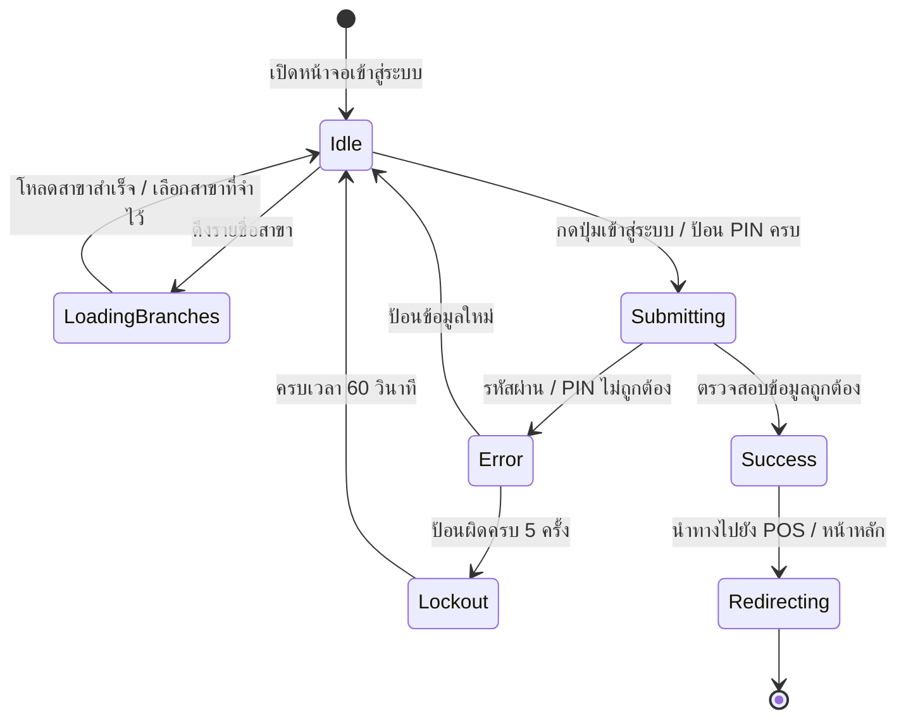

# Data Model: ระบบเข้าสู่ระบบสำหรับผู้ใช้งานและแคชเชียร์ (User & Cashier Authentication)

**Feature**: `001-user-login`
**Date**: 2026-10-21
**Status**: Ready

## 1. ข้อมูลการยืนยันตัวตนและการเข้าสู่ระบบ (Authentication Data Models)

### 1.1 บัญชีผู้ใช้งาน (User Account / Profile)
ข้อมูลตัวตนของผู้ใช้งานที่ส่งกลับมาจากระบบหลังยืนยันตัวตนสำเร็จ หรือดึงจาก `/api/v1/auth/me`

| Field | Type | Description | Constraints |
| :--- | :--- | :--- | :--- |
| `id` | `string` (UUID) | รหัสประจำตัวผู้ใช้งานในระบบ | Primary Identifier |
| `username` | `string` | ชื่อผู้ใช้งานสำหรับเข้าสู่ระบบ | Unique, 3-50 ตัวอักษร |
| `fullName` | `string` | ชื่อ-นามสกุลจริงของพนักงาน | Required |
| `role` | `string` | ระดับสิทธิ์ เช่น `ADMIN`, `MANAGER`, `CASHIER` | Required Enum |
| `branchId` | `string` (UUID) | รหัสสาขาที่ผู้ใช้สังกัดอยู่ | Nullable สำหรับ Admin รวม |
| `isActive` | `boolean` | สถานะการเปิดใช้งานบัญชี | Default: `true` |

---

### 1.2 สาขา (Branch)
ข้อมูลสาขาที่เปิดให้บริการสำหรับให้แคชเชียร์เลือกในโหมด PIN

| Field | Type | Description | Constraints |
| :--- | :--- | :--- | :--- |
| `id` | `string` (UUID) | รหัสสาขา | Primary Identifier |
| `code` | `string` | รหัสย่อของสาขา (เช่น `BKK01`) | Unique |
| `name` | `string` | ชื่อทางการของสาขา | Required |
| `isActive` | `boolean` | สถานะการเปิดดำเนินการ | Filter เฉพาะที่ `true` |

---

### 1.3 โทเค็นและเซสชัน (Auth Tokens & Session)
ข้อมูลการยืนยันตัวตนที่ได้รับจาก API เพื่อใช้ส่งแนบใน Header `Authorization: Bearer <accessToken>`

| Field | Type | Description | Storage |
| :--- | :--- | :--- | :--- |
| `accessToken` | `string` (JWT) | Access Token สำหรับเรียกใช้งาน API ต่างๆ | `localStorage` |
| `refreshToken` | `string` | Refresh Token สำหรับขอต่ออายุ Access Token | `localStorage` |
| `user` | `UserProfile` | ข้อมูลผู้ใช้งานที่เข้าสู่ระบบ | `localStorage` |
| `branch` | `Branch` | สาขาที่กำลังปฏิบัติงาน | `localStorage` |

---

### 1.4 ข้อมูลสำหรับส่งเข้าสู่ระบบ (Credentials DTO)

#### 1.4.1 Username & Password Login Request (`LoginRequest`)
- `username`: string (ความยาวอย่างน้อย 1 ตัวอักษร, ห้ามว่างเปล่า)
- `password`: string (ความยาวอย่างน้อย 1 ตัวอักษร, ห้ามว่างเปล่า)

#### 1.4.2 Quick PIN Login Request (`PinLoginRequest`)
- `branchId`: string (UUID สาขาที่เลือก, ห้ามว่างเปล่า)
- `pin`: string (ตัวเลขล้วน ความยาว 4-8 หลัก)

---

## 2. สถานะการทำงานของหน้าจอ (UI State Models)

### 2.1 สถานะของหน้าจอ Login (`LoginUIState`)

```typescript
export type LoginMode = 'pin' | 'credentials';

export interface LoginUIState {
  mode: LoginMode;
  selectedBranchId: string;
  branches: Branch[];
  isLoadingBranches: boolean;
  username: string;
  password: string;
  showPassword: boolean;
  pin: string;
  isSubmitting: boolean;
  errorMessage: string | null;
  failedAttempts: number;
  lockoutUntil: number | null; // Timestamp เมื่อถูกระงับชั่วคราว
}
```

### 2.2 ข้อมูลตั้งค่าอุปกรณ์ (Device Preferences)
จัดเก็บไว้ใน `localStorage` ของเบราว์เซอร์:
- `ice_pos_last_branch_id`: string (UUID)
- `ice_pos_last_login_mode`: `'pin' | 'credentials'`

---

## 3. วงจรสถานะและการเปลี่ยนสถานะ (State Transitions)


