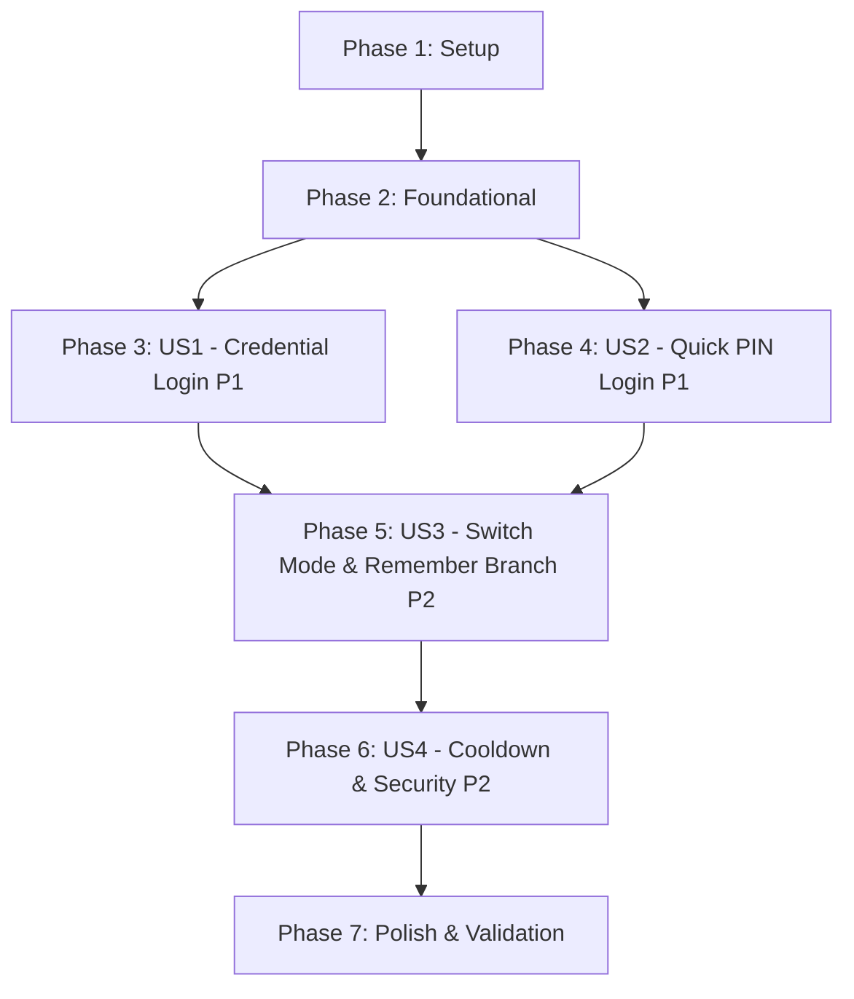

# Tasks: ระบบเข้าสู่ระบบสำหรับผู้ใช้งานและแคชเชียร์ (User & Cashier Authentication)

**Feature**: `001-user-login` | **Date**: 2026-10-21
**Input Artifacts**:
- Specification: [spec.md](file:///Users/chanchai/workshop/CODE/ice-pos-web/specs/001-user-login/spec.md)
- Implementation Plan: [plan.md](file:///Users/chanchai/workshop/CODE/ice-pos-web/specs/001-user-login/plan.md)
- Data Model: [data-model.md](file:///Users/chanchai/workshop/CODE/ice-pos-web/specs/001-user-login/data-model.md)
- API Contracts: [auth.contract.ts](file:///Users/chanchai/workshop/CODE/ice-pos-web/specs/001-user-login/contracts/auth.contract.ts)
- Validation Guide: [quickstart.md](file:///Users/chanchai/workshop/CODE/ice-pos-web/specs/001-user-login/quickstart.md)

---

## Phase 1: Setup (Shared Infrastructure)

**Purpose**: โครงสร้างพื้นฐาน Type Definitions, Utility สำหรับ LocalStorage และ API Client กลาง

- [x] T001 [P] Create TypeScript types and interfaces for authentication in src/types/auth.ts
- [x] T002 [P] Create browser storage helpers for JWT tokens, user session, and device preferences in src/utils/storage.ts
- [x] T003 [P] Create base API HTTP client with Fetch wrapper, error envelope parser, and JWT header interceptor in src/services/api.ts

---

## Phase 2: Foundational (Core Auth Services & Context)

**Purpose**: Service กลางสำหรับเรียก Authentication API และ Context สำหรับจัดการสถานะผู้ใช้

**⚠️ CRITICAL**: ต้องดำเนินการให้เสร็จสิ้นก่อนเริ่มพัฒนา User Stories

- [x] T004 Create authentication service implementing login, pinLogin, me, and branches API endpoints in src/services/auth.service.ts
- [x] T005 [P] Create AuthContext and session hook for managing authenticated user state and branch in src/context/AuthContext.tsx

**Checkpoint**: Foundation พร้อมทำงาน — สามารถเริ่มพัฒนา User Stories ได้

---

## Phase 3: User Story 1 - การเข้าสู่ระบบด้วยชื่อผู้ใช้งานและรหัสผ่าน (Priority: P1) 🎯 MVP

**Goal**: ผู้ใช้งาน (ผู้ดูแลระบบ, ผู้จัดการ, พนักงานทั่วไป) สามารถเข้าสู่ระบบด้วย Username & Password ได้อย่างถูกต้องและปลอดภัย

**Independent Test**: กรอก Username/Password ที่ถูกต้องแล้วเข้าสู่ระบบสำเร็จ บันทึก Token ลง Storage และนำทางสู่หน้าหลักของระบบ

### Implementation for User Story 1

- [x] T006 [P] [US1] Create Username & Password form component with Show/Hide password toggle in src/components/auth/CredentialLogin.tsx
- [x] T007 [US1] Implement credential submission logic with client-side validation and loading state in src/components/auth/CredentialLogin.tsx
- [x] T008 [US1] Integrate CredentialLogin into login page at src/app/(auth)/login/page.tsx with redirect to dashboard upon success

**Checkpoint**: User Story 1 ใช้งานและทดสอบเดี่ยวได้สมบูรณ์ (MVP)

---

## Phase 4: User Story 2 - การเข้าสู่ระบบด่วนด้วยรหัส PIN สำหรับแคชเชียร์ (Priority: P1)

**Goal**: พนักงานแคชเชียร์สามารถเลือกสาขา และกดป้อนรหัส PIN 4-8 หลักผ่านแผงตัวเลขเสมือนหรือคีย์บอร์ดจริงเพื่อเข้าสู่หน้าขาย POS ได้อย่างรวดเร็ว

**Independent Test**: เลือกสาขาและป้อนรหัส PIN ที่ถูกต้องครบตามจำนวนหลัก ระบบตรวจสอบสิทธิ์และนำทางเข้าสู่หน้าขายหน้าร้าน (POS Terminal) ทันทีเสมอ

### Implementation for User Story 2

- [x] T009 [P] [US2] Create touch-friendly Virtual Numpad component (0-9, Backspace, Clear) supporting physical keyboard events in src/components/auth/VirtualNumpad.tsx
- [x] T010 [P] [US2] Create Branch selection dropdown/modal with auto-fetch and search in src/components/auth/BranchSelector.tsx
- [x] T011 [US2] Create PinLogin component combining BranchSelector, PIN masked dots, and VirtualNumpad in src/components/auth/PinLogin.tsx
- [x] T012 [US2] Implement PIN submission logic and direct navigation to POS Terminal upon success in src/components/auth/PinLogin.tsx

**Checkpoint**: User Story 2 ใช้งานและทดสอบเดี่ยวได้สมบูรณ์ แคชเชียร์เปิดหน้าขายหน้าร้านได้สะดวกรวดเร็ว

---

## Phase 5: User Story 3 - การสลับโหมดเข้าใช้งานและการจดจำสาขาล่าสุด (Priority: P2)

**Goal**: ผู้ใช้งานสามารถสลับโหมดระหว่าง Username/Password และ PIN ได้อย่างราบรื่น โดยเปิดหน้าจอครั้งแรกเป็นโหมด PIN และจดจำสาขา/โหมดล่าสุดบนอุปกรณ์

**Independent Test**: เปิดหน้าจอเข้าสู่ระบบแล้วระบบแสดงโหมด PIN และเลือกสาขาที่เคยบันทึกไว้ใน LocalStorage อัตโนมัติ พร้อมสลับโหมดได้ทันทีโดยไม่ต้องรีโหลดหน้าเว็บ

### Implementation for User Story 3

- [x] T013 [P] [US3] Create ModeSwitcher tab component for toggling between PIN and Credential modes in src/components/auth/ModeSwitcher.tsx
- [x] T014 [US3] Create container LoginForm managing active mode, branch auto-selection, and device preference persistence in src/components/auth/LoginForm.tsx
- [x] T015 [US3] Update login page at src/app/(auth)/login/page.tsx to render LoginForm and handle redirect routing for both roles

**Checkpoint**: User Story 1, 2, และ 3 ผสานการทำงานร่วมกันได้อย่างสมบูรณ์

---

## Phase 6: User Story 4 - การรักษาความปลอดภัยและการจัดการข้อผิดพลาด (Priority: P2)

**Goal**: แสดงข้อความแจ้งเตือนข้อผิดพลาดภาษาไทยที่เข้าใจง่าย และระงับการลองชั่วคราวเป็นเวลา 60 วินาทีเมื่อป้อนรหัสผิดติดต่อกันครบ 5 ครั้ง

**Independent Test**: ป้อนรหัสผ่านหรือ PIN ผิดติดต่อกัน 5 ครั้ง ระบบแสดงตัวเลขนับเวลาถอยหลัง (Cooldown) 60 วินาที และปิดปุ่มส่งข้อมูลจนกว่าจะครบเวลา

### Implementation for User Story 4

- [ ] T016 [P] [US4] Create CooldownTimer countdown component with countdown seconds badge in src/components/auth/CooldownTimer.tsx
- [ ] T017 [US4] Integrate consecutive failed attempts counter, cooldown trigger (5 failures / 60s), and Thai error alert handling in src/components/auth/LoginForm.tsx

**Checkpoint**: ความปลอดภัยหน้าร้านและการจัดการข้อผิดพลาดสมบูรณ์ตามข้อกำหนดความปลอดภัย

---

## Phase 7: Polish & Cross-Cutting Concerns

**Purpose**: ปรับแต่งความสมบูรณ์ ความสวยงาม และการทดสอบระบบทั้งหมด

- [ ] T018 [P] Add root route redirect from src/app/page.tsx to /login when unauthenticated
- [ ] T019 [P] Verify Thai typography, responsive design for tablet/touchscreens, and Tailwind v4 styling in src/app/globals.css
- [ ] T020 Run end-to-end validation scenarios per specs/001-user-login/quickstart.md
- [ ] T021 Run linting and TypeScript strict type checking with npm run lint and npx tsc --noEmit

---

## Dependencies & Execution Order

### Phase Dependencies

- **Setup (Phase 1)**: ไม่มี Dependency — เริ่มได้ทันที
- **Foundational (Phase 2)**: ขึ้นอยู่กับ Phase 1 — เป็น Prerequisites ของทุก User Stories
- **User Story 1 (Phase 3)**: ขึ้นอยู่กับ Phase 2 — เป็น MVP ตัวแรก
- **User Story 2 (Phase 4)**: ขึ้นอยู่กับ Phase 2 — สามารถเริ่มพัฒนาควบคู่กับ Phase 3 ได้
- **User Story 3 (Phase 5)**: ขึ้นอยู่กับ Phase 3 และ Phase 4
- **User Story 4 (Phase 6)**: ขึ้นอยู่กับ Phase 5
- **Polish (Phase 7)**: ขึ้นอยู่กับทุก User Story

### User Story Dependencies



### Parallel Opportunities

- **Phase 1**: T001, T002, T003 สามารถทำคู่ขนานกันได้
- **Phase 2**: T004 และ T005 สามารถทำคู่ขนานกันได้หลังจาก T001-T003 เสร็จ
- **Phase 3 & 4**: สามารถพัฒนาควบคู่กันได้ (เช่น พัฒนา `CredentialLogin.tsx` ควบคู่กับ `VirtualNumpad.tsx` และ `BranchSelector.tsx`)
- **Phase 7**: T018, T019 สามารถทำคู่ขนานกันได้

---

## Parallel Execution Examples

```bash
# พัฒนาโครงสร้างข้อมูลและ Client ร่วมกัน:
Task T001: "Create TypeScript types and interfaces for authentication in src/types/auth.ts"
Task T002: "Create browser storage helpers for JWT tokens in src/utils/storage.ts"
Task T003: "Create base API HTTP client with Fetch wrapper in src/services/api.ts"

# พัฒนา UI Components ของโหมด PIN ควบคู่กัน:
Task T009: "Create touch-friendly Virtual Numpad component in src/components/auth/VirtualNumpad.tsx"
Task T010: "Create Branch selection dropdown in src/components/auth/BranchSelector.tsx"
```

---

## Implementation Strategy

### MVP First (User Story 1 Only)
1. ดำเนินการ Phase 1 (Setup)
2. ดำเนินการ Phase 2 (Foundational)
3. ดำเนินการ Phase 3 (User Story 1: Username & Password Login)
4. **ตรวจสอบและทดสอบ**: ทดสอบเข้าสู่ระบบได้สำเร็จ สามารถส่งมอบเวอร์ชันเริ่มต้นได้ทันที

### Incremental Delivery (ส่งมอบทีละขั้น)
1. **Increment 1 (MVP)**: เข้าสู่ระบบด้วย Username & Password ได้ (Phase 1, 2, 3)
2. **Increment 2**: เพิ่มการเข้าสู่ระบบด่วนด้วย PIN + Virtual Numpad สำหรับแคชเชียร์ (Phase 4)
3. **Increment 3**: รวม 2 โหมดเข้าด้วยกันพร้อมจดจำสาขาและโหมดล่าสุด (Phase 5)
4. **Increment 4**: เสริมระบบความปลอดภัย Cooldown 60 วินาทีและการจัดการข้อผิดพลาด (Phase 6, 7)
