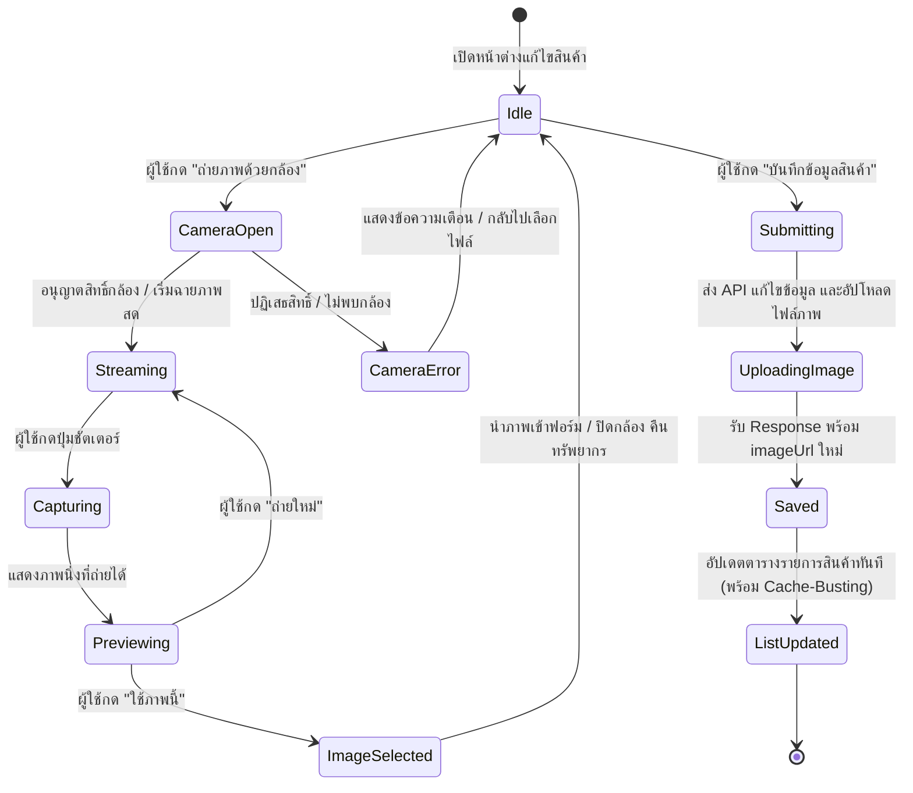

# Data Model: การแก้ไขข้อมูลสินค้า (ถ่ายภาพโดยตรงและแสดงผลในหน้ารายการทันที)

**Feature**: `003-edit-product-photo`
**Date**: 2026-10-21
**Status**: Completed

## 1. ข้อมูลเอนทิตี (Entities)

### Product (สินค้า)
ข้อมูลสินค้าหลักในระบบแคตตาล็อก

| ฟิลด์ | ชนิดข้อมูล | เงื่อนไข / ข้อจำกัด | คำอธิบาย |
| :--- | :--- | :--- | :--- |
| `id` | string (UUID) | Required, Unique | รหัสประจำตัวสินค้า |
| `sku` | string | Required, Max 50 chars | รหัสสินค้า |
| `name` | string | Required, Max 100 chars | ชื่อสินค้า |
| `barcode` | string \| null | Optional, Max 50 chars | บาร์โค้ดสินค้า |
| `isInternalBarcode` | boolean | Required, Default false | เป็นบาร์โค้ดที่ระบบสร้างขึ้นเองหรือไม่ |
| `categoryId` | string \| null | Optional | รหัสหมวดหมู่สินค้า |
| `baseUomId` | string | Required | รหัสหน่วยนับหลัก |
| `productType` | string | Required ('STANDARD' \| 'SERIALIZED' \| etc.) | ประเภทสินค้า |
| `price` | number (integer) | Required, >= 0 | ราคาขาย (หน่วยเป็นสตางค์) |
| `costPerBaseUnit` | number (integer) | Optional, >= 0 | ต้นทุนสินค้า (หน่วยเป็นสตางค์) |
| `taxId` | string \| null | Optional | รหัสภาษี |
| `minStock` | number | Optional, Default 0 | ระดับสต็อกขั้นต่ำ |
| `trackExpiry` | boolean | Required, Default false | ตรวจสอบวันหมดอายุหรือไม่ |
| `isActive` | boolean | Required, Default true | สถานะเปิด/ปิดจำหน่าย |
| `description` | string \| null | Optional | รายละเอียดสินค้า |
| `imageUrl` | string \| null | Optional | URL ที่อยู่ของรูปภาพสินค้า |
| `updatedAt` | string (ISO date) | Optional / Managed | วันที่และเวลาที่อัปเดตข้อมูลล่าสุด |
| `imageTimestamp` | number | Frontend State Only | Timestamp สำหรับ Cache-Busting รูปภาพ |

---

### CameraDeviceState (สถานะอุปกรณ์กล้อง)
สถานะการทำงานของกล้องในฝั่ง Frontend

| ฟิลด์ | ชนิดข้อมูล | คำอธิบาย |
| :--- | :--- | :--- |
| `isStreaming` | boolean | กำลังรับสัญญาณภาพจากกล้องอยู่หรือไม่ |
| `facingMode` | 'user' \| 'environment' | ทิศทางกล้อง ('user' = กล้องหน้า, 'environment' = กล้องหลัง) |
| `hasMultipleCameras` | boolean | อุปกรณ์มีกล้องมากกว่าหนึ่งตัวหรือไม่ |
| `error` | string \| null | ข้อความแจ้งเตือนข้อผิดพลาด (เช่น ไม่ได้รับสิทธิ์ หรือไม่พบกล้อง) |
| `capturedDataUrl` | string \| null | Data URL ของภาพนิ่งที่จับภาพได้สำหรับการพรีวิวตรวจสอบ |

---

### CapturedImageResult (ผลลัพธ์ภาพที่จับภาพได้)
โครงสร้างข้อมูลภาพถ่ายที่พร้อมส่งต่อให้ฟอร์มสินค้า

| ฟิลด์ | ชนิดข้อมูล | คำอธิบาย |
| :--- | :--- | :--- |
| `file` | File | อ็อบเจกต์ File (เช่น `product-photo-[timestamp].jpg`) พร้อมอัปโหลด |
| `previewUrl` | string | Object URL สำหรับการแสดงภาพตัวอย่างทันทีในแบบฟอร์ม |
| `blob` | Blob | ข้อมูล Binary Blob ของภาพ |
| `width` | number | ความกว้างของภาพ (พิกเซล) |
| `height` | number | ความสูงของภาพ (พิกเซล) |

---

## 2. วงจรสถานะของรูปภาพสินค้า (Lifecycle / State Transitions)

