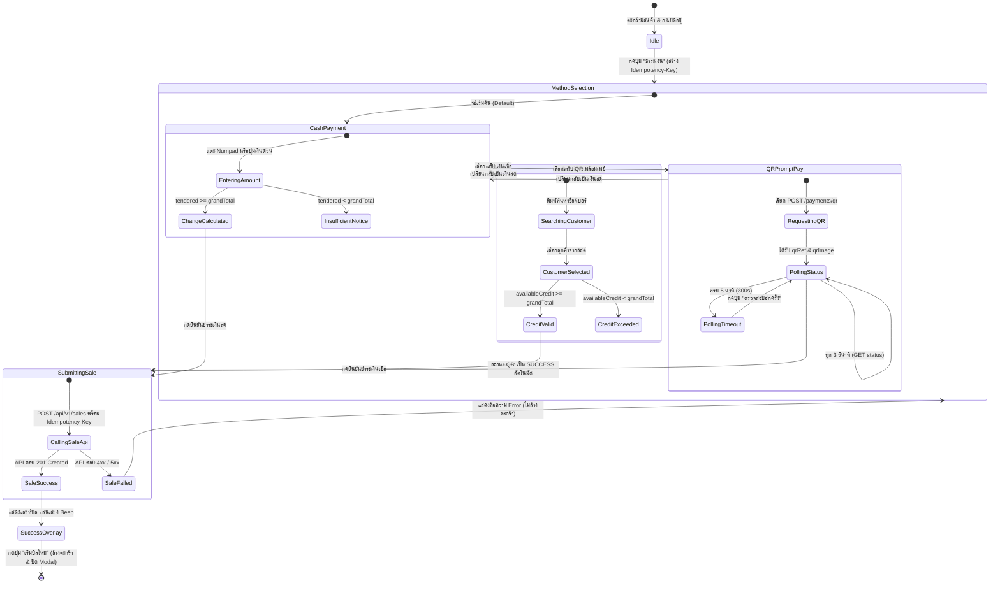

# Data Model: ระบบชำระเงินหน้าร้านและบันทึกการขาย (POS Checkout & Payment)

**Feature Branch**: `005-pos-checkout-payment`  
**Date**: 2026-10-23  
**Status**: Completed  
**Spec Reference**: [spec.md](spec.md)

---

## 1. ข้อมูลโมเดลสำหรับตะกร้าและการชำระเงิน (Cart & Checkout Models)

### 1.1 `CartItem` (ปรับปรุงจากเดิม)
โมเดลตัวแทนสินค้า 1 แถวในตะกร้าขาย เพิ่มฟิลด์ `uomId` สำหรับส่งต่อให้ระบบขาย

```typescript
export interface CartItem {
  id: string;              // รหัสระบุรายการในตะกร้า (UUID หรือ Product ID)
  productId: string;       // รหัสสินค้า (UUID)
  name: string;            // ชื่อสินค้าภาษาไทย
  sku: string;             // รหัส SKU
  barcode?: string;        // รหัสบาร์โค้ด
  price: number;           // ราคาขายต่อหน่วย (หน่วยสตางค์: satang)
  quantity: number;        // จำนวนสินค้า (รองรับทศนิยมสำหรับสินค้าชั่งน้ำหนัก)
  uomId: string;           // รหัสหน่วยนับสินค้า (UUID จาก product.baseUomId หรือ baseUom.id) [NEW]
  uomName: string;         // ชื่อหน่วยนับแสดงผล (เช่น "ถุง", "ขวด", "กิโลกรัม")
  imageUrl?: string;       // URL รูปภาพสินค้า
  categoryName?: string;   // ชื่อหมวดหมู่สินค้า
  taxRatePercent: number;  // อัตราภาษีมูลค่าเพิ่ม (%)
  pricingType: 'PIECE' | 'WEIGHT'; // รูปแบบการคิดราคา
  lineTotal: number;       // ยอดรวมแถวนี้ (price * quantity) ในหน่วยสตางค์
}
```

**Validation Rules**:
- `productId`: ต้องไม่ว่างเปล่า (UUID format)
- `uomId`: ต้องมีค่าเสมอ (ห้ามเป็น empty string หรือ null) หากสินค้าไม่มี `uomId` จะไม่อนุญาตให้ทำการ checkout
- `quantity`: ต้องมากกว่า 0 (`quantity > 0`)
- `price`: ต้องไม่ติดลบ (`price >= 0`)

---

### 1.2 `CheckoutSession`
ข้อมูลสถานะการทำงานภายในหน้าต่างชำระเงิน (`PosCheckoutModal`)

```typescript
export type PaymentMethodType = 'CASH' | 'QR_PROMPTPAY' | 'CREDIT' | 'CARD' | 'TRANSFER';

export interface CheckoutSession {
  idempotencyKey: string;           // UUID ป้องกันการทำรายการซ้ำ (สร้างใหม่ทุกครั้งที่เปิด Modal)
  paymentMethod: PaymentMethodType; // วิธีการชำระเงินที่เลือก (ค่าเริ่มต้น: 'CASH')
  grandTotalSatang: number;         // ยอดเงินสุทธิที่ต้องชำระ (หน่วยสตางค์)
  
  // เฉพาะการชำระด้วยเงินสด (CASH)
  tenderedSatang: number;           // จำนวนเงินที่รับจากลูกค้า (หน่วยสตางค์)
  changeSatang: number;             // เงินทอนที่ต้องคืน (tenderedSatang - grandTotalSatang)
  isExactAmount: boolean;           // ธงระบุว่าจ่ายพอดีหรือไม่
  
  // เฉพาะการชำระผ่าน QR พร้อมเพย์ (QR_PROMPTPAY)
  qrRef?: string;                   // รหัสอ้างอิง QR สำหรับ polling
  qrImageUrl?: string;              // URL รูปภาพ QR สำหรับแสดงผลให้ลูกค้าสแกน
  qrStatus: 'IDLE' | 'GENERATING' | 'WAITING' | 'SUCCESS' | 'TIMEOUT' | 'ERROR';
  qrSecondsRemaining: number;       // เวลานับถอยหลังก่อน timeout (เริ่มต้น 300 วินาที / 5 นาที)
  
  // เฉพาะการชำระด้วยเงินเชื่อ (CREDIT)
  selectedCustomer?: CustomerSummary | null; // ลูกค้าที่เลือก
  creditLimitSatang?: number;       // วงเงินเครดิตสูงสุด
  outstandingBalanceSatang?: number;// ยอดหนี้ค้างชำระเดิม
  remainingCreditSatang?: number;   // วงเงินเครดิตคงเหลือที่ใช้ได้
  
  // สถานะการบันทึกรายการ
  isSubmitting: boolean;            // กำลังส่ง API POST /sales
  errorMessage?: string | null;     // ข้อความข้อผิดพลาดภาษาไทย (ถ้ามี)
  saleResult?: SaleResponse | null; // ข้อมูลผลลัพธ์การขายเมื่อสำเร็จ
}
```

---

## 2. ข้อมูลคำขอและผลลัพธ์จาก API (API Request & Response DTOs)

### 2.1 `CreateSaleRequest`
โครงสร้างข้อมูลสำหรับเรียก `POST /api/v1/sales` (อ้างอิง Swagger API)

```typescript
export interface CreateSaleRequest {
  branchId: string;                 // รหัสสาขา (UUID)
  idempotencyKey: string;           // UUID สุ่มป้องกันการบันทึกซ้ำ
  billDiscount: number;             // ส่วนลดระดับบิล (ส่งค่า 0 ในเฟสนี้)
  customerId?: string;              // รหัสลูกค้า (เฉพาะเมื่อชำระด้วย CREDIT)
  note?: string;                    // หมายเหตุบิลขาย
  occurredAt?: string;              // วันเวลาที่เกิดรายการ ISO8601 (ไม่ระบุ = เวลาปัจจุบัน)
  lines: CreateSaleLineItem[];      // รายการสินค้าที่ขาย
  payments: CreateSalePayment[];    // รายการการชำระเงิน
}

export interface CreateSaleLineItem {
  productId: string;                // รหัสสินค้า (UUID)
  uomId: string;                    // รหัสหน่วยนับ (UUID)
  qty: number;                      // จำนวนสินค้าที่ขาย
  unitPrice: number;                // ราคาต่อหน่วย (หน่วยสตางค์: satang)
  lineDiscount: number;             // ส่วนลดรายแถว (ส่งค่า 0 ในเฟสนี้)
}

export interface CreateSalePayment {
  method: PaymentMethodType;        // วิธีชำระเงิน
  amount: number;                   // จำนวนเงินที่ตัดชำระ (หน่วยสตางค์: เท่ากับ grandTotal)
  tenderedAmount?: number;          // จำนวนเงินที่รับมา (หน่วยสตางค์: เฉพาะเงินสด)
  changeAmount?: number;            // จำนวนเงินทอน (หน่วยสตางค์: เฉพาะเงินสด)
  ref?: string;                     // รหัสอ้างอิง (เช่น qrRef หรือหมายเลขสลิป)
}
```

---

### 2.2 `SaleResponse`
ผลลัพธ์ที่ได้รับจากการบันทึกการขายสำเร็จ

```typescript
export interface SaleResponse {
  id: string;                       // รหัสบิลขาย (UUID)
  saleNo: string;                   // เลขที่บิลขาย (เช่น "BR-000104")
  branchId: string;                 // รหัสสาขา
  shiftId?: string;                 // รหัสกะการขาย
  cashierId: string;                // รหัสแคชเชียร์ผู้ทำรายการ
  customerId?: string;              // รหัสลูกค้า
  status: 'COMPLETED' | 'VOIDED';   // สถานะบิลขาย
  grandTotal: number;               // ยอดสุทธิทั้งบิล (หน่วยสตางค์)
  billDiscount: number;             // ส่วนลดระดับบิล (หน่วยสตางค์)
  lines: SaleLineResponse[];        // รายการสินค้าที่บันทึกแล้ว
  payments: SalePaymentResponse[];  // รายการการชำระเงินที่บันทึกแล้ว
  createdAt: string;                // วันเวลาที่สร้างบิล
}

export interface SaleLineResponse {
  id: string;
  productId: string;
  productName: string;
  uomId: string;
  uomName: string;
  quantity: number;
  unitPrice: number;
  lineTotal: number;
}

export interface SalePaymentResponse {
  id: string;
  method: PaymentMethodType;
  amount: number;
  tenderedAmount?: number;
  changeAmount?: number;
  ref?: string;
}
```

---

### 2.3 `QRPayment` โมเดล
ข้อมูลสำหรับการสร้างและตรวจสอบสถานะ QR พร้อมเพย์

```typescript
export interface GenerateQRRequest {
  amount: number;                   // ยอดเงินที่ต้องการรับชำระ (หน่วยสตางค์)
}

export interface QRPaymentResponse {
  qrRef: string;                    // รหัสอ้างอิง QR สำหรับตรวจสอบสถานะ
  qrImageUrl: string;               // URL รูปภาพ QR พร้อมเพย์
  amount: number;                   // ยอดเงินใน QR (หน่วยสตางค์)
  status: 'PENDING' | 'SUCCESS' | 'EXPIRED' | 'CANCELLED';
  createdAt: string;
}
```

---

### 2.4 `CustomerSummary` สำหรับการชำระด้วยเงินเชื่อ
ข้อมูลลูกค้าสำหรับค้นหาและเลือกในขั้นตอนชำระเงินเชื่อ

```typescript
export interface CustomerSummary {
  id: string;                       // รหัสลูกค้า (UUID)
  code: string;                     // รหัสอ้างอิงลูกค้า (เช่น "CUST-0001")
  name: string;                     // ชื่อลูกค้าหรือชื่อร้านค้า
  phone?: string;                   // เบอร์โทรศัพท์
  creditLimit: number;              // วงเงินเครดิตสูงสุดที่ได้รับ (หน่วยสตางค์)
  outstandingBalance: number;       // ยอดหนี้คงค้างปัจจุบัน (หน่วยสตางค์)
  availableCredit: number;          // วงเงินคงเหลือที่ใช้ได้ (creditLimit - outstandingBalance)
  isActive: boolean;
}
```

---

## 3. แผนผังการเปลี่ยนสถานะการทำงาน (State Transitions)


