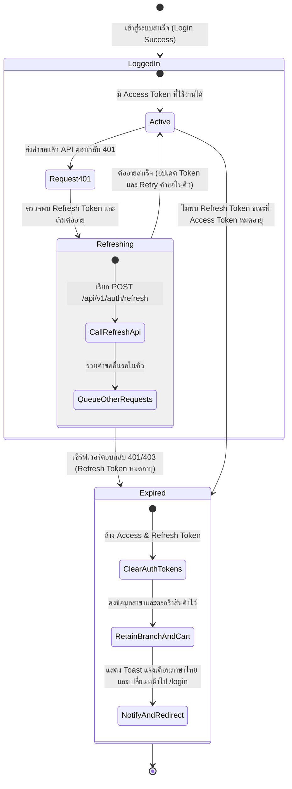

# Data Model: Continuous Usage Token Refresh & Idle Session Timeout

**Branch**: `008-auth-token-refresh`  
**Feature**: `specs/008-auth-token-refresh/spec.md`  

## Entities & Type Definitions

### 1. Token Refresh Interceptor State (`src/services/api.ts`)

โครงสร้างข้อมูลภายในตัวจัดการคำขอ API เพื่อบริหารจัดการการต่ออายุ Token แบบไม่พร้อมกัน (Asynchronous)

```typescript
/**
 * สถานะการขอต่ออายุ Token เบื้องหลัง
 */
export interface TokenRefreshCoordinatorState {
  /** กำลังอยู่ในกระบวนการขอ Token ใหม่อยู่หรือไม่ */
  isRefreshing: boolean;

  /** Promise ของการเรียกขอ Token ใหม่ในรอบปัจจุบัน เพื่อให้คำขออื่นรอผลลัพธ์ร่วมกัน */
  refreshPromise: Promise<string> | null;

  /** คิวของคำขอที่รอ Token ใหม่เพื่อส่งซ้ำ */
  queuedRequests: Array<{
    resolve: (token: string) => void;
    reject: (error: unknown) => void;
  }>;
}
```

---

### 2. Session Lifecycle Events & Handlers (`src/types/auth.ts`)

ประเภทข้อมูลสำหรับการส่งสัญญาณสถานะเซสชันของระบบ

```typescript
/**
 * เหตุการณ์เกี่ยวกับวงจรชีวิตของเซสชันผู้ใช้งาน
 */
export type SessionEventType = 
  | 'SESSION_REFRESHED'     // ต่ออายุสิทธิ์สำเร็จ
  | 'SESSION_EXPIRED'       // เซสชันหมดอายุจริงและต้องออกจากระบบ
  | 'SESSION_NETWORK_ERROR'; // เกิดปัญหาเครือข่ายระหว่างติดต่อระบบ

/**
 * รายละเอียดของเหตุการณ์เซสชัน
 */
export interface SessionEventPayload {
  type: SessionEventType;
  message?: string;
  timestamp: number;
}

/**
 * ฟังก์ชัน Callback สำหรับลงทะเบียนรับฟังเหตุการณ์เซสชันหมดอายุ
 */
export type SessionExpiredListener = (payload: SessionEventPayload) => void;
```

---

### 3. Session Persistence Model (`src/utils/storage.ts`)

การกำหนดการจัดเก็บข้อมูลเมื่อเซสชันหมดอายุ (Session Expiration Policy)

| Storage Key | ชนิดข้อมูล | พฤติกรรมเมื่อเซสชันหมดอายุ | เหตุผล |
|-------------|-----------|-------------------------|-------|
| `ice_pos_access_token` | string | **ล้างทิ้ง (Remove)** | ป้องกันการใช้ Token เดิมที่ไม่ถูกต้อง |
| `ice_pos_refresh_token` | string | **ล้างทิ้ง (Remove)** | ป้องกันการวนลูปเรียก Refresh ซ้ำ |
| `ice_pos_user_profile` | UserProfile | **ล้างทิ้ง (Remove)** | ถือว่าผู้ใช้งานออกจากระบบแล้ว |
| `ice_pos_current_branch` | Branch | **คงไว้ (Retain)** | เพื่อแสดงชื่อสาขาเดิมในหน้าจอ PIN Login ทันที |
| `ice_pos_last_branch_id` | string | **คงไว้ (Retain)** | เพื่อใช้เป็น Default Branch สำหรับการล็อกอินใหม่ |
| `ice_pos_cart_*` | CartItem[] | **คงไว้ (Retain)** | เพื่อให้แคชเชียร์สามารถขายสินค้าต่อได้ทันทีหลังใส่ PIN |

---

## State Transition Diagram


