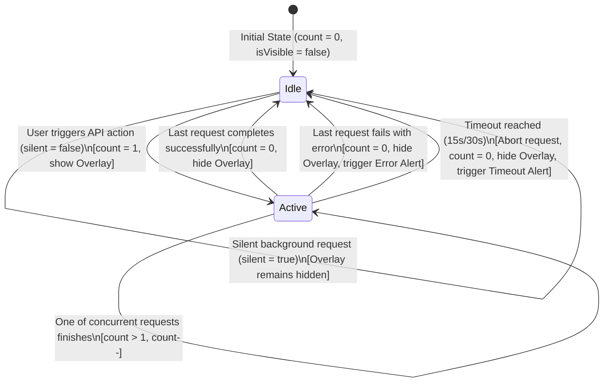

# Data Model: กลไกและสถานะของ Global Loading Overlay

**Feature**: `010-api-action-overlay` | **Date**: 2026-10-25

## 1. Entities & Interfaces

### 1.1 OverlayState
ตัวแทนสถานะการแสดงผลของ Global Loading Overlay ในระดับ Runtime

```typescript
export interface OverlayState {
  /**
   * สถานะการเปิด/ปิดการแสดงผลของ Overlay
   */
  isVisible: boolean;

  /**
   * ข้อความภาษาไทยที่แสดงบน Overlay (เช่น "กำลังบันทึกข้อมูล...", "กำลังประมวลผล...")
   */
  message: string;

  /**
   * ตัวนับจำนวนคำขอ API ที่กำลังดำเนินการอยู่และไม่ได้เป็นแบบเงียบ (Reference Counting)
   */
  activeRequestsCount: number;

  /**
   * เวลาที่เริ่มแสดง Overlay (Timestamp ms) สำหรับคำนวณและตรวจสอบ Timeout
   */
  startTime: number | null;
}
```

### 1.2 Extended RequestOptions
การขยายพารามิเตอร์ของ `RequestOptions` ใน `src/types/auth.ts` เพื่อให้รองรับการควบคุม Overlay

```typescript
export interface RequestOptions extends RequestInit {
  params?: Record<string, string | number | boolean | undefined>;
  _isRetry?: boolean;

  /**
   * ข้อความภาษาไทยที่ต้องการให้แสดงบน Overlay เฉพาะคำขอนี้
   * หากไม่ระบุ จะใช้ข้อความเริ่มต้น "กำลังดำเนินการ กรุณารอสักครู่..."
   */
  loadingMessage?: string;

  /**
   * ระบุว่าคำขอนี้เป็นงานประมวลผลเบื้องหลังแบบเงียบหรือไม่ (เช่น Silent Token Refresh, Polling)
   * หากเป็น true จะไม่แสดง Full-Screen Overlay และไม่เพิ่มตัวนับคำขอ
   */
  silent?: boolean;

  /**
   * ระยะเวลา Timeout เฉพาะคำขอนี้ (หน่วยมิลลิวินาที)
   * ค่าเริ่มต้น: 15,000ms สำหรับคำขอทั่วไป, 30,000ms สำหรับธุรกรรมชำระเงิน
   */
  timeoutMs?: number;
}
```

### 1.3 OverlayCoordinatorListener
ประเภทฟังก์ชัน Callback สำหรับการแจ้งเตือนการเปลี่ยนแปลงสถานะ

```typescript
export type OverlayListener = (state: OverlayState) => void;
```

---

## 2. State Transition & Lifecycle (วงจรชีวิตสถานะ)



### กฎการเปลี่ยนสถานะ (Transition Rules):
1. **เริ่มคำขอ (`startRequest`)**:
   - หาก `silent === true` → ข้ามการเปลี่ยนสถานะ
   - หาก `silent !== true` → `activeRequestsCount++`, อัปเดต `message`, และตั้ง `isVisible = true`
2. **สิ้นสุดคำขอ (`endRequest`)**:
   - หาก `silent === true` → ข้ามการเปลี่ยนสถานะ
   - หาก `silent !== true` → `activeRequestsCount = Math.max(0, activeRequestsCount - 1)`
   - หาก `activeRequestsCount === 0` → ตั้ง `isVisible = false`, รีเซ็ต `message` และ `startTime = null`
3. **ตัดการทำงานฉุกเฉิน (`emergencyReset`)**:
   - ตั้ง `activeRequestsCount = 0`, `isVisible = false`, รีเซ็ตสถานะทั้งหมดทันที
