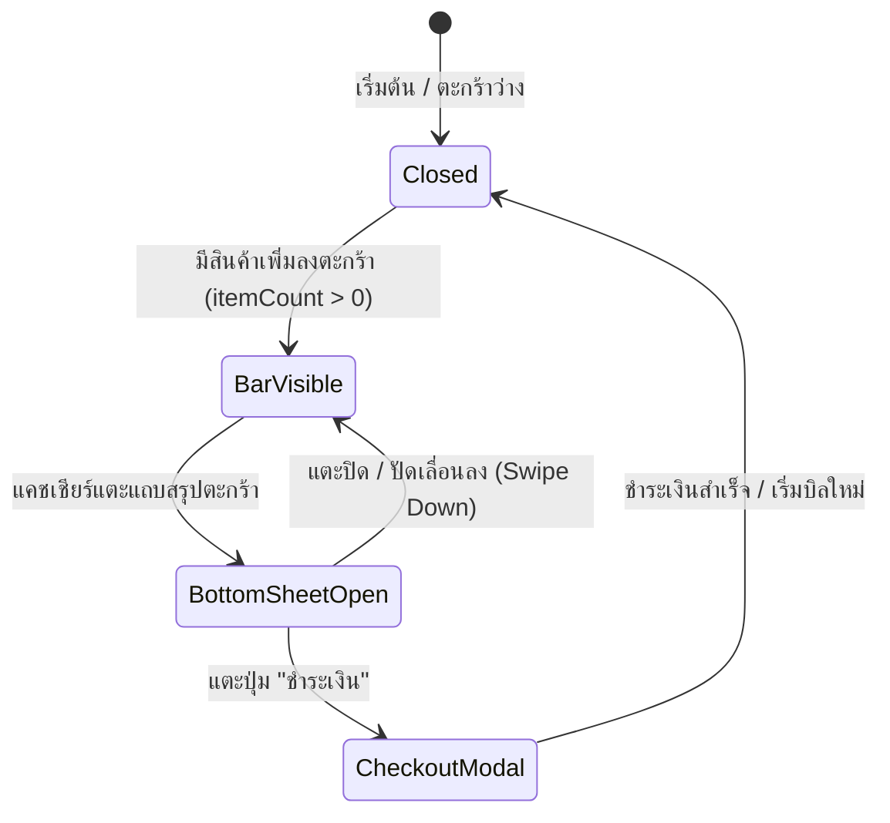

# Data Model & State Architecture: Mobile & Tablet POS Usability and Login Alignment

**Feature Branch**: `011-mobile-tablet-pos-ux`
**Date**: 2026-10-25

## 1. UI State Entities

### 1.1 Mobile Cart UI State (`MobileCartState`)
สถานะควบคุมการเปิด-ปิด และการแสดงผลลิ้นชักตะกร้าสินค้าบนหน้าจอพกพา

| Field | Type | Required | Description | Constraints |
|---|---|---|---|---|
| `isCartOpen` | `boolean` | Yes | สถานะว่าลิ้นชัก Bottom Sheet เปิดอยู่หรือไม่ | ค่าเริ่มต้น `false` |
| `itemCount` | `number` | Yes | จำนวนชิ้นสินค้ารวมในตะกร้า | คำนวณจาก `items.reduce((sum, it) => sum + it.quantity, 0)` |
| `totalAmount` | `number` | Yes | ยอดเงินรวมสุทธิในตะกร้า (บาท) | คำนวณจาก `items.reduce((sum, it) => sum + (it.price * it.quantity), 0)` |
| `canCheckout` | `boolean` | Yes | พร้อมชำระเงินหรือไม่ | `itemCount > 0 && isShiftActive` |

### 1.2 Bottom Navigation Item (`BottomNavItem`)
โครงสร้างข้อมูลสำหรับรายการเมนูบนแถบนำทางด้านล่าง

| Field | Type | Required | Description |
|---|---|---|---|
| `key` | `string` | Yes | รหัสระบุรายการเมนู เช่น `'pos'`, `'catalog'`, `'menu'` |
| `label` | `string` | Yes | ข้อความภาษาไทยกำกับเมนู เช่น `'หน้าขาย'`, `'สินค้า'`, `'เมนู'` |
| `href` | `string` | Optional | ลิงก์นำทาง URL (หากเป็นลิงก์) |
| `icon` | `React.ComponentType` | Yes | ไอคอน SVG สำหรับเมนู |
| `isActive` | `boolean` | Yes | สถานะว่ากำลังเปิดหน้านี้อยู่หรือไม่ |
| `badge` | `number` | Optional | ตัวเลข Badge แจ้งเตือน (เช่น จำนวนสินค้าในตะกร้า) |
| `onClick` | `() => void` | Optional | ฟังก์ชัน Callback สำหรับปุ่มการกระทำ (เช่น เปิด Drawer) |

## 2. Component Hierarchy & Flow

```text
[MainLayout] (src/app/(main)/layout.tsx)
  ├── [AppHeader] (เดสก์ท็อป และส่วนหัวโมบายล์)
  ├── [AppSidebar] (เดสก์ท็อปขยาย/หด, โมบายล์ Drawer Overlay)
  ├── <main> (พื้นที่แสดงผลหน้าแต่ละ Route เช่น /pos, /catalog)
  │     └── [PosPage]
  │           ├── [PosShiftBanner]
  │           ├── [PosProductCatalog] (เต็มจอเมื่อ < 1024px, 60% เมื่อ >= 1024px)
  │           ├── [PosCartPanel] (แสดงเฉพาะ >= 1024px)
  │           ├── [PosCartFloatingBar] (แสดงเฉพาะ < 1024px เหนือ BottomNav)
  │           └── [PosCartBottomSheet] (ลิ้นชักตะกร้าเลื่อนเปิดเมื่อกดดูตะกร้า)
  └── [AppBottomNav] (แถบนำทางระดับแอพ แสดงเฉพาะ < 1024px)
```

## 3. State Lifecycle Transitions


