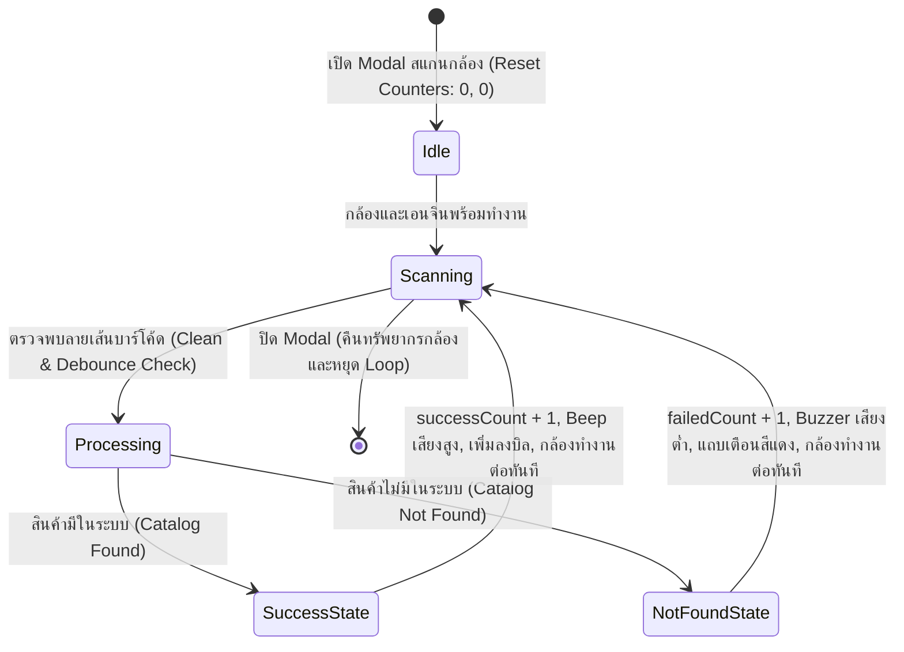

# Data Model: ระบบสแกนบาร์โค้ดผ่านกล้องและตัวนับจำนวน

**Feature Branch**: `013-barcode-scan-fix-and-counters`  
**Date**: 2026-10-26  

## 1. Entities & Data Structures

### 1.1 `ScanSessionCounters`
โครงสร้างข้อมูลตัวนับจำนวนสินค้าในรอบการเปิดกล้องสแกนปัจจุบัน (Active Camera Session)

| ฟิลด์ | ชนิดข้อมูล | เงื่อนไข / คำอธิบาย |
|---|---|---|
| `successCount` | `number` | จำนวนสินค้าที่สแกนสำเร็จและมีข้อมูลในระบบ (ค่าเริ่มต้น 0, >= 0) |
| `failedCount` | `number` | จำนวนครั้งที่สแกนพบบาร์โค้ดแต่ไม่พบสินค้าในระบบ หรือค้นหาด้วยมือแล้วไม่พบ (ค่าเริ่มต้น 0, >= 0) |
| `totalAttempts` | `number` | ผลรวมของจำนวนการสแกนทั้งหมด (`successCount + failedCount`) |

### 1.2 `ScanFeedbackResult`
ข้อมูลผลลัพธ์การสแกนครั้งล่าสุดที่แสดงบนแถบสถานะของ Modal

| ฟิลด์ | ชนิดข้อมูล | ค่าที่อนุญาต / เงื่อนไข | คำอธิบาย |
|---|---|---|---|
| `status` | `'SUCCESS' \| 'NOT_FOUND'` | ค่าต้องเป็น `'SUCCESS'` หรือ `'NOT_FOUND'` เท่านั้น | สถานะผลลัพธ์ของการสแกนล่าสุด |
| `barcode` | `string` | ความยาว >= 1 ตัวอักษร หลังทำความสะอาดช่องว่าง | รหัสบาร์โค้ดที่สแกนได้ |
| `productName` | `string?` | มีค่าเมื่อ `status === 'SUCCESS'` เท่านั้น | ชื่อสินค้าที่ค้นพบในระบบ |
| `timestamp` | `number` | Unix timestamp (มิลลิวินาที) | เวลาที่ตรวจพบล่าสุด |

### 1.3 `BarcodeScanHandlerResult`
ค่าที่ส่งกลับจาก Callback `onScan` ใน `src/app/(main)/pos/page.tsx` ส่งให้ Modal ทราบสถานะ

| ฟิลด์ | ชนิดข้อมูล | เงื่อนไข | คำอธิบาย |
|---|---|---|---|
| `success` | `boolean` | `true` หากพบสินค้าในแคชหรือ API สำเร็จ, `false` หากไม่พบหรือเกิดข้อผิดพลาด | ผลการค้นหาและเพิ่มลงบิล |
| `productName` | `string?` | มีค่าเมื่อ `success === true` | ชื่อสินค้าที่เพิ่มลงตะกร้า |

## 2. State Lifecycle & Transitions

## 3. Data Integrity & Validation Rules

1. **Debounce Interval**: ป้องกันการนับรหัสเดิมซ้ำซ้อนภายในระยะเวลา **1,500 มิลลิวินาที** (`1.5 วินาที`)
2. **Barcode Cleaning**: ล้างอักขระควบคุม (ASCII non-printable characters) และช่องว่างหัวท้ายก่อนส่งประมวลผล
3. **Session Reset**: ตัวนับ `successCount` และ `failedCount` จะถูกรีเซ็ตเป็น 0 ทุกครั้งที่เปิด Modal ใหม่ในรอบการขาย
4. **Immediate Continuous Scan**: ไม่มีการระงับการทำงานของกล้องเมื่อเกิด `NOT_FOUND` เพื่อให้แคชเชียร์แยกสินค้าที่มีปัญหาและสแกนสินค้าชิ้นถัดไปได้ทันที
