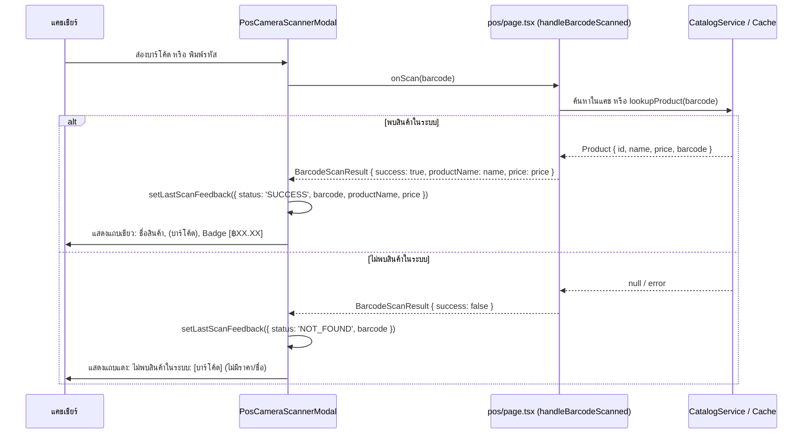

# Data Model: 014-scan-product-info-display

**Feature**: แสดงข้อมูลสินค้าที่สแกนพบ (เลขบาร์โค้ด ชื่อสินค้า ราคา) และแสดงเฉพาะบาร์โค้ดเมื่อไม่พบสินค้า
**Branch**: `014-scan-product-info-display`
**Date**: 2026-10-26

## Entity & Interface Definitions

### 1. `BarcodeScanResult`
ผลลัพธ์การประมวลผลการค้นหาบาร์โค้ดที่ส่งกลับจาก Callback `onScan` (เช่น จาก `handleBarcodeScanned` ใน `src/app/(main)/pos/page.tsx` ไปยัง `PosCameraScannerModal`)

| ฟิลด์ (Field) | ชนิดข้อมูล (Type) | ความจำเป็น (Required) | คำอธิบาย (Description) |
| :--- | :--- | :--- | :--- |
| `success` | `boolean` | จำเป็น (Required) | สถานะการค้นหา (`true` = พบสินค้าในระบบและเพิ่มลงบิลแล้ว, `false` = ไม่พบสินค้าในระบบ) |
| `productName` | `string` | ทางเลือก (Optional) | ชื่อสินค้าที่ค้นพบ (มีค่าเมื่อ `success === true`) |
| `price` | `number` | ทางเลือก (Optional) | ราคาขายต่อหน่วยของสินค้า (มีค่าเมื่อ `success === true`, ค่าเป็นบวกหรือ 0) |

---

### 2. `ScanFeedbackResult`
สถานะผลลัพธ์การสแกนล่าสุดที่บันทึกไว้ใน State ของ `PosCameraScannerModal` เพื่อนำไปเรนเดอร์ในแถบแจ้งเตือนผลลัพธ์ (Recent Scan Banner)

| ฟิลด์ (Field) | ชนิดข้อมูล (Type) | ความจำเป็น (Required) | คำอธิบาย (Description) |
| :--- | :--- | :--- | :--- |
| `status` | `'SUCCESS' \| 'NOT_FOUND'` | จำเป็น (Required) | ผลการสแกนรอบล่าสุด |
| `barcode` | `string` | จำเป็น (Required) | รหัสบาร์โค้ดที่สแกนติด (ผ่านการทำความสะอาดแล้ว) |
| `productName` | `string` | ทางเลือก (Optional) | ชื่อสินค้า (มีเฉพาะกรณี `status === 'SUCCESS'`) |
| `price` | `number` | ทางเลือก (Optional) | ราคาขายต่อหน่วย (มีเฉพาะกรณี `status === 'SUCCESS'`) |
| `timestamp` | `number` | จำเป็น (Required) | เวลาที่สแกน (Unix timestamp ในหน่วยมิลลิวินาที) |

---

## Data Flow & Lifecycle Transitions

## Validation & Formatting Rules

1. **ราคา (Price Formatting)**:
   - แปลงตัวเลข `price` ให้อยู่ในรูปสกุลเงินบาทเสมอ: `฿${price.toLocaleString('th-TH', { minimumFractionDigits: 2, maximumFractionDigits: 2 })}`
   - หาก `price` เป็น `undefined` หรือ `null` เมื่อ `status === 'SUCCESS'`: แสดงเป็น `฿0.00`
2. **บาร์โค้ด (Barcode Display)**:
   - แสดงด้วยฟอนต์ `font-mono` เสมอ เพื่อให้อักขระไม่คลาดเคลื่อน
3. **กรณีไม่พบสินค้า (Not Found Guarantee)**:
   - ตรวจสอบให้แน่ใจว่าไม่มีฟิลด์ `price` หรือ `productName` ถูกส่งเข้ามาเรนเดอร์ในกรณี `status === 'NOT_FOUND'`
